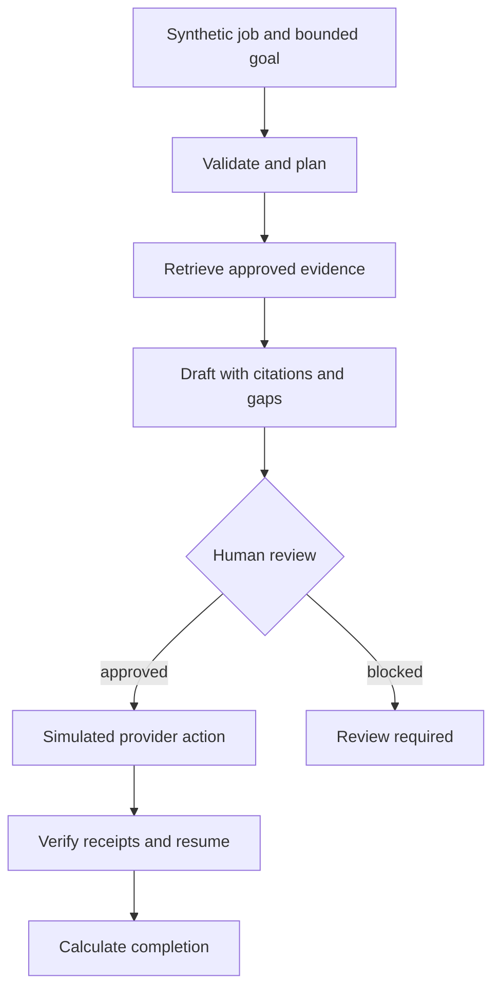

# LinkedIn + Atlas L1 assignment

Build a small simulated workflow that turns a synthetic job requirement into an evidence-backed fit explanation and moves an approved simulated application through verified completion gates. You will implement 12 focused functions. The environment, adapters, tests, and graph wiring are provided.

This is interview preparation for the Capgemini AI Engineer opportunity. On 13 November 2026 Jyothesh reported clearing the assessment and progressing to L1. The interview date and format are unknown. These exercises are preparation hypotheses, not private employer interview questions.

## Branches and edit boundaries

| Branch | Purpose | Starting state |
|---|---|---|
| `main` | Your implementation workspace | 12 task functions raise `NotImplementedError`; infrastructure is supplied |
| `coach-reference` | Builder-tested implementation of the same contracts | Complete reference implementation |

Stay on `main` for independent work. The reference branch is accessible to you; it is not a secure hidden answer bank. Record viewing or copying its solutions as assistance. Change only the task bodies initially. Preserve signatures, public tests, synthetic fixtures, and adapter contracts. Larger changes belong in a separately explained experiment.

## Start

```bash
uv run l1-lab doctor
uv run pytest -m infrastructure
uv run pytest -m m1
```

The first two commands check the environment. Milestone tests initially fail because the task functions are unfinished. A `NotImplementedError` is an honest baseline, not a setup failure or a passed task. Tests must not be skipped or marked expected-to-fail to hide the unfinished work.

## Function and test map

| Milestone | File in `src/l1_lab/` | Function | Main test selection |
|---|---|---|---|
| M1 — Python contracts | `contracts.py` | `parse_job` | `uv run pytest -m m1` |
| M1 — Python contracts | `contracts.py` | `normalize_identity` | `uv run pytest -m m1` |
| M2 — Agent control | `agent.py` | `validate_tool_call` | `uv run pytest -m m2` |
| M2 — Agent control | `agent.py` | `retry_allowed` | `uv run pytest -m m2` |
| M3 — Knowledge ingestion | `knowledge.py` | `select_records` | `uv run pytest -m m3` |
| M3 — Knowledge ingestion | `knowledge.py` | `chunk_records` | `uv run pytest -m m3` |
| M4 — Retrieval | `retrieval.py` | `rank_hits` | `uv run pytest -m m4` |
| M5 — Grounded responses | `grounding.py` | `build_context` | `uv run pytest -m m5` |
| M5 — Grounded responses | `grounding.py` | `validate_answer` | `uv run pytest -m m5` |
| M6 — Integration and evaluation | `agent.py` | `completion_gates` | `uv run pytest -m m6` |
| M6 — Integration and evaluation | `evaluation.py` | `compare_runs` | `uv run pytest -m m6` |
| M6 — Integration and evaluation | `progress.py` | `compute_metrics` | `uv run pytest -m m6` |

Use the docstring and public tests of each function as the exact executable contract. [LEARNING_PATH.md](LEARNING_PATH.md) explains the mechanism, boundaries, checkpoints, and changed scenarios without providing solved bodies.

## What you are building



The LangGraph nodes are ordinary Python functions. The planner proposes calls; deterministic validation controls names, arguments, permissions, and budgets before execution. Retrieved text is evidence, never authority to change those controls.

## Modes and data

| Mode | Retrieval | Generation | Network requirement |
|---|---|---|---|
| `offline` | Deterministic test embeddings and local vector search | Fixture adapter | No paid API or model download |
| `semantic` | Actual FastEmbed model and Qdrant local search | Adapter identified by the command/report | Model download first; cached weights thereafter |
| `live` | Configured retrieval | Optional configured model adapter | Credentials and provider availability |

Semantic retrieval is not proof of live answer generation. Live planning and live answer generation must each be reported separately. See `BUILD_REPORT.md` for what the builder actually exercised.

Tracked fixtures are synthetic. A real Atlas export is a read-only snapshot with explicit provenance and import instructions. It is not a live connection or continuous synchronisation. Keep private snapshots, embeddings, traces, receipts, and progress under ignored local directories. No learning adapter writes operational records back to Atlas.

## Completion evidence

After implementing each milestone:

1. Run its targeted tests and explain one important boundary.
2. Diagnose one fresh changed scenario without copying a reference solution.
3. Record the command and actual result, plus any hints, reference exposure, or copied code.

Passing tests establishes the tested behavior. It does not establish your explanation, independent authorship, official assessment score, or interview readiness. Your initial competence is unmeasured: empty practice denominators are `N/A`.

All employer submissions, outreach, document storage, Atlas commits, and delivery receipts in this lab are simulated. The review command approves a simulation only. Receipt identifiers begin with `sim:`.

## Final review

Run the full suite when the milestone tests pass, inspect an offline evaluation report, and complete the blueprint in [COACH_HANDOVER.md](COACH_HANDOVER.md) with a coach who creates fresh scenarios. Keep the final mock questions unexposed until that session.
