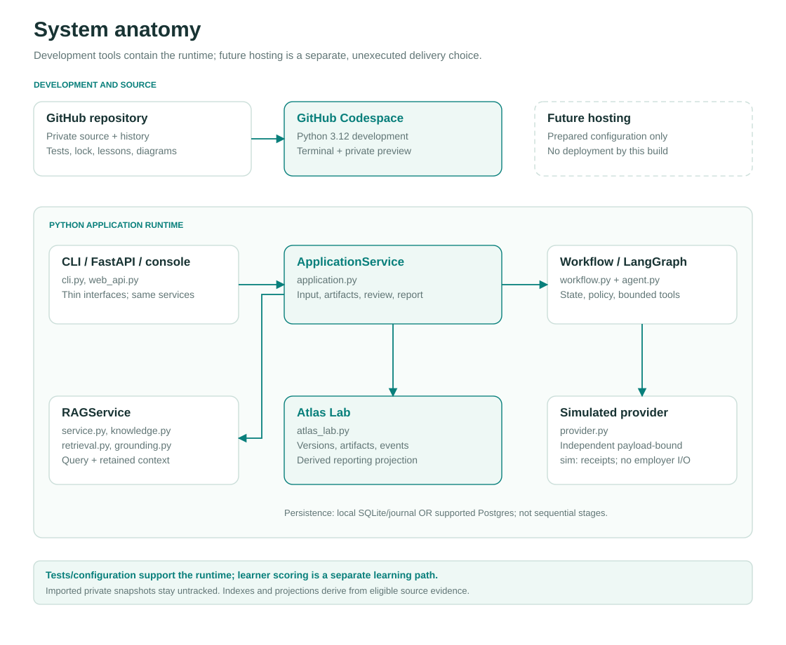

# LinkedIn Agent Development Lab

This is a complete Python application for investigating agent engineering through a LinkedIn-style workflow and an isolated Atlas Lab evidence store. `main` is the working product. The original twelve-function scaffold/reference history is retained; optional experiments no longer gate the application.

The project began in **2026**. Stable GitHub repository ID: **1456774523**, owner **jyotheshkar**. Resolve the current name from that identity when an older URL redirects; do not create a duplicate repository. The current README and fresh verification report identify the canonical URL, preserved baseline, final commit and observed Codespace state.

## Launch

In the repository's private Codespace:

```bash
uv sync --locked --extra lab
uv run l1-lab doctor
uv run uvicorn app:app --host 0.0.0.0 --port 8000
```

Open the private forwarded port at `/console`. A Codespace preview is a development session, not durable production hosting. Read actual mode indicators: source, retrieval, planner, generation and effects are independent.

For a terminal-first inspection:

```bash
uv run l1-lab demo --mode offline --query 'Python evaluation'
uv run l1-lab run --goal 'prepare application'
uv run pytest tests/test_contracts.py -q
```

Review the actual artifact bytes, target, payload and digest before approving consequential simulation actions. Every application/outreach outcome is a **SIMULATION**. No operational LinkedIn, Gmail, Atlas Sheets/Drive or production-dashboard writer is authorized by this build.

## See the system, then one file



Begin with [ANATOMY-01](docs/learning/01-anatomy.md), then [CONTRACTS-01](docs/learning/02-contracts.md). Read `src/l1_lab/contracts.py` and `tests/test_contracts.py` together. Trace a valid job and a rejected Boolean budget before changing anything.

The [lesson index](docs/learning/lesson-index.json) links exact symbols, test targets, diagrams and optional experiments. The [architecture guide](docs/architecture/README.md) separates runtime, development and future hosting. [JD coverage](docs/JD_COVERAGE.md) maps mechanisms to the recruiter-provided role.

## Continue in another chat

Read [CHAT_BOOTSTRAP.md](CHAT_BOOTSTRAP.md) and [COACH_HANDOVER.md](COACH_HANDOVER.md). A private link does not automatically grant another assistant file access. Export one bounded lesson context if needed:

```bash
uv run l1-lab context-export --lesson CONTRACTS-01 --output .lab/context.json
```

Review the export before sharing. Builder-generated code and test results do not establish independent competence; the baseline remains unmeasured until observed attempts are reviewed.

[docs/VERIFICATION.md](docs/VERIFICATION.md) owns fresh execution results and remaining gaps. Older build reports preserve history. Deployment preparation is separate from an observed hosted deployment, and this build stops before deployment.
