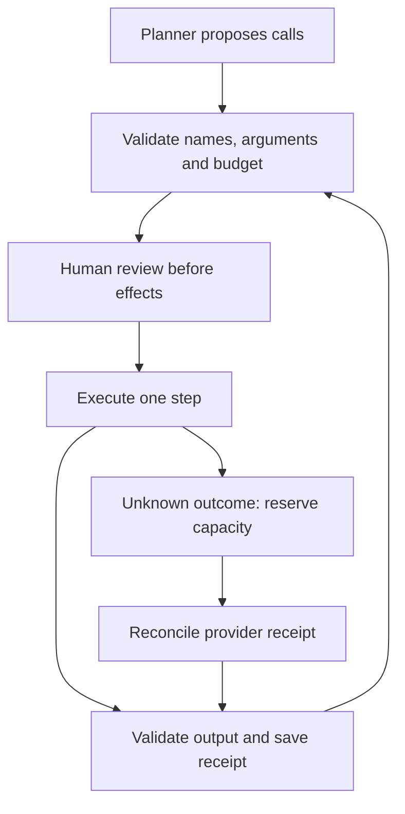

# Agent control and simulated recovery

This is a learning workflow. The offline planner is a deterministic fixture
policy, and every provider effect is local simulation. Neither the tool
registry nor the fake provider has a Gmail, employer or Atlas write adapter.

## Provided execution path



`Workflow` compiles a LangGraph `StateGraph` with one ordinary Python execution
node and a conditional transition. Persisted state remains explicit and
inspectable in the local JSON journal. It contains the plan, step index,
attempt counters, accepted outputs, verified receipts and trace events.
The graph wiring is provided; it does not hide a second decision engine.

`OfflinePlanner.plan(goal)` demonstrates three different valid plans:

| Goal | Proposed work | External simulation review |
| --- | --- | --- |
| `inspect evidence` | Retrieve only | None; no effect |
| `draft a fit explanation` | Retrieve and draft | Draft remains reviewable |
| `apply to a synthetic role` | Retrieve, draft, five simulated effects | Required before the first effect |

An injected live planner uses the same `.plan(goal) -> list[dict]` interface.
Its output passes the same deterministic tool validation and execution path.
Live planning is a separate integration from live answer generation.

## Your edit boundaries

| Task | File and function | Input/output | Failure contract |
| --- | --- | --- | --- |
| M2-A | `src/l1_lab/agent.py::validate_tool_call` | Proposal, registry, allowlist, remaining calls -> detached validated proposal | `GuardrailError` for bad shape, name, permission, arguments or budget |
| M2-B | `src/l1_lab/agent.py::retry_allowed` | Error, one-based attempt, additional retries -> Boolean | Invalid attempt/policy -> `ValueError`; guardrail, permanent and unknown outcomes do not retry |
| M6-A | `src/l1_lab/agent.py::completion_gates` | Five named receipt slots -> gate Booleans and `complete` | Missing, pending, mismatched or nonsimulation receipts do not earn credit |

Replace only the body of each named function. Preserve its signature and
documented exceptions. Framework nodes, provider storage, schemas and journal
code are provided, rather than additional assessed TODOs.

The `ToolSpec` registry separates strict argument schemas, an execution
callable, the effect flag and the completion gate. The effect flag is an
application-controlled property; a retrieved document cannot set it. Pydantic
schemas forbid extra arguments and use strict field types. Tool names are a
fixed allowlist. Retrieved text remains nested output data, so embedded
instructions cannot approve a run or increase its budget.

## Attempts, retries and capacity

`attempt=1` means the initial execution. `max_retries=1` permits at most one
additional execution of that step. Every actual execution consumes one global
tool call; reconciliation reads do not re-execute a tool. The seven-call apply
plan has a default eight-call budget, allowing one extra execution overall.
Only `TransientError` declares a known pre-effect safe retry. Output validation
and permission failures stop for review.

`UnknownOutcome` means the action may already exist at the provider. The run
keeps its current step and in-flight identity, reserves its place, and stops
with `status="pending"`. Resuming reads the provider receipt before any new
effect. If the provider has no decisive receipt, the run remains pending; it
does not blindly repeat the request.

The fake provider stores receipts in its own SQLite database, independently
of the workflow journal. Therefore a response timeout or journal write failure
after provider commit is a real recoverable local scenario. It is not simulated
by merely returning the same hash from a stateless function.

## Identity, approval and completion

Effect arguments use a normalized target identity. A provider key binds that
target to the action gate across run IDs. The provider retains one receipt for
the key and binds the exact payload fingerprint to it. A changed payload with
the same key is rejected. The CLI should pass the normalized company/job
identity to `OfflinePlanner(target_identity=...)`; the planner's fallback is
a deterministic synthetic identity derived from the goal.

These guarantees belong to the fake provider's unique-key and payload-binding
contract. Computing a hash alone cannot guarantee exactly-once delivery to an
external service. This lab is a single-operator local exercise, not a claim of
production concurrency, distributed transactions or successful employer
delivery.

Human review approves the persisted immutable plan. Changing the plan after
the checkpoint blocks the run instead of inheriting previous approval.
All subsequent effects belong to that reviewed plan and its fixed budget.

`status="completed"` describes termination of the selected **plan**. The
explicit `completion.plan` and `completion.full_unit` fields distinguish that
from completing an application unit. An inspect-only plan finishes with
`completion.full_unit=false`. A full unit needs five independent verified
`sim:` receipts: application, outreach, storage, commit and delivery. A pending
delivery receipt withholds full-unit credit.

## Running the public checks

```bash
python -m pytest -q -m m2
python -m pytest -q -m m6
```

M2 checks can pass after M1 and the two M2 tasks. Full completion and recovery
checks belong to M6 so that they do not secretly require a later TODO during
M2. The initial student branch deliberately fails the task checks until the
corresponding functions are implemented. Infrastructure checks exercise
provided graph construction, planner variation and fake-provider persistence
without pretending to solve student functions.

Use fake-provider injections to inspect failures through the Python API:

```python
from pathlib import Path
from l1_lab.workflow import Workflow

workflow = Workflow(Path(".lab-state"))
workflow.provider.inject("application", "unknown_after")
paused = workflow.start("apply to a synthetic role", run_id="recovery-demo")
pending = workflow.resume("recovery-demo", approved=True)
recovered = Workflow(Path(".lab-state")).resume("recovery-demo")
```

The first resume must return pending after one provider effect. The next
resume reconciles it and continues without creating a duplicate. Inspect
`calls`, `attempts`, `receipts`, `in_flight` and `trace`; trace events omit raw
tool arguments and document text. Raw local state remains private and ignored
by Git.

## Explanation and fresh variants

After M2, explain why a transient pre-effect failure and an unknown outcome
need different control paths. Trace which exact write precedes the first
provider effect, and why that matters after a crash. Do not equate passing
tests with a complete independent explanation.

For a changed scenario, require review again if a proposed payload changes
after approval, while preserving a verified earlier receipt. Define acceptance
tests before coding. For M6, change delivery to remain pending across two
restarts, then finalize the fake receipt. The full-unit gate must become true
only after reconciliation verifies that final receipt. The tutoring chat will
provide a fresh unexposed scenario rather than asking you to repeat a reference
answer.

## Implementation reference

The graph API was checked against the official
[LangGraph workflows and agents documentation](https://docs.langchain.com/oss/python/langgraph/workflows-agents)
on 13 November 2026. The implementation uses `StateGraph`, `START`, `END`,
`add_node`, `add_conditional_edges`, `compile` and `invoke`. Actual dependency
versions and executed verification belong in `BUILD_REPORT.md`.
