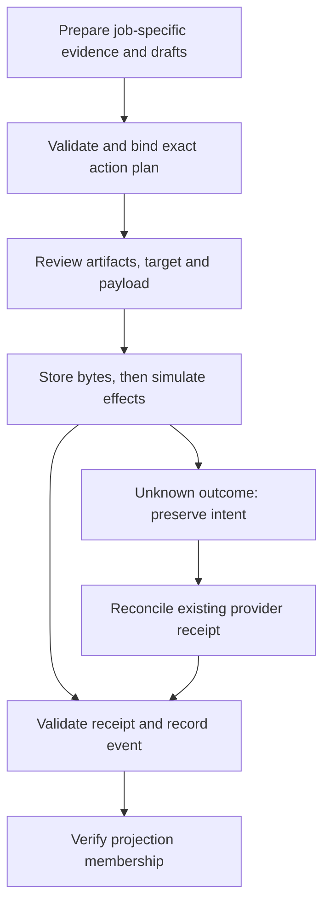

# Agent control and simulated recovery

The default product is complete. This document explains the working control path; optional investigations are in [AGENT-01](learning/03-agent-control.md) and [WORKFLOW-01](learning/04-workflow-recovery.md). There are no mandatory assessed TODOs.

## Shared application path

`ApplicationService.prepare` validates the actual job/goal, reads eligible Atlas Lab knowledge, retrieves evidence and writes job-specific application/outreach draft bytes. It persists provenance, source versions, artifact digests and policy identity. `PreparedPlanner` hands a content-bound plan to the existing LangGraph `Workflow`; it does not bypass `validate_tool_call` or executor budgets.

The complete route orders reviewed storage before dependent application/outreach simulation. The earlier standalone `OfflinePlanner` remains a small fixture adapter for the engine's direct tests; it is not proof that a model planned a real application. Optional `OpenAIPlanner` proposals still pass deterministic name/schema/permission/budget checks and are bound to actual prepared material before execution.



## The core contracts

| Complete symbol | Responsibility | Boundary |
|---|---|---|
| `validate_tool_call` | Known/permitted tool, strict args, finite call budget, detached accepted data | Proposal text cannot grant permission |
| `retry_allowed` | Retry only declared known pre-effect transient errors within additional-retry limit | Unknown outcomes, validation and permanent failures do not blindly retry |
| `completion_gates` | Independent verified simulation receipt evidence | Pending, absent, reused or mismatched receipts do not earn full-unit credit |
| `ApplicationService.resume` | Recheck exact preparation/review, reconstruct persisted inputs and repair reporting | No regeneration of an approved payload or dependence on a prior process cache |

Edit experiments only in an isolated copy/branch. Preserve working application signatures and meaningful public tests unless a deliberate contract change is explained and tested.

## Attempts, outcomes and stable identities

Attempt 1 is the initial execution. `max_retries=1` permits one additional attempt; every actual execution consumes the bounded tool budget. Reconciliation is a receipt read, not another provider execution. Inspect the actual prepared plan and supplied job budget instead of assuming every goal has the same number of calls.

The provider stores payload-bound `sim:` receipts independently of the run journal. A successful effect followed by response/journal failure is recoverable because the receipt survives. The journal retains an in-flight intent; unknown completion stays pending and reserves the existing target. A new run must not hide that work.

Keys bind canonical target/action identity. The provider enforces uniqueness and exact payload fingerprint; reconciliation verifies that the receipt belongs to the persisted call, including payload binding. A hash alone does not establish exactly-once external delivery. This remains a local simulated provider, not an employer API.

## Review and reporting

Owner action approval is separate from source-record approval. Review binds job identity, action, actual artifact/version/hash, source bindings and policy. Changed sources, artifacts or payload invalidate prior approval and require fresh review. Model-supplied approval fields have no authority.

`ApplicationService` stores actual reviewed bytes before dependent submission simulation. Application and outreach are distinct effects using the relevant registered material. Atlas Lab event storage and projection revision/membership are separately verified. Repair logging or projection without repeating employer simulations.

`status=completed` can describe a finished inspect/draft plan. `completion.full_unit` needs all evidence gates, intact stored material and verified reporting. Pending delivery or projection prevents full completion.

## Inspect meaningful checks

```bash
uv run pytest tests/test_agent.py tests/test_workflow.py -q
uv run pytest tests/test_atlas_lab.py -q
```

Use temporary-store failure injections to study pre-effect transient failure, effect-success/response-timeout, invalid output, changed payload and projection repair. Read the actual tests before adapting them. The test results support observed software behavior, not independent learner explanations or unexecuted integrations.

Declared pre-effect transient retries use fixed capped exponential backoff:
50, 100 and at most 200 milliseconds. The constructor permits at most three
additional retries, so cumulative backoff is at most 350 milliseconds; tool-call
budgets still count every execution. Unknown outcomes, invalid output and
permanent failures do not enter this retry path. The trace records requested
backoff separately from the measured execution duration.

Ctrl-C or an asynchronous cancellation raised during graph execution stops the
current invocation and preserves its durable journal. A possible side effect
retains its in-flight identity in `pending` state for reconciliation before
continuing; cancellation during pre-effect backoff records `cancelled` without
inventing an effect. An explicit later resume continues the same reviewed
request. Cancellation does not forcibly terminate an arbitrary synchronous
callable. Model SDK calls have their separately configured 30-second timeout
and no hidden automatic retries.

The graph API uses ordinary Python functions inside LangGraph `StateGraph`, with explicit persisted state and termination. See the current lock and [fresh verification](VERIFICATION.md) for versions/results. [State/recovery diagram](architecture/state-recovery.svg) is the component map.
