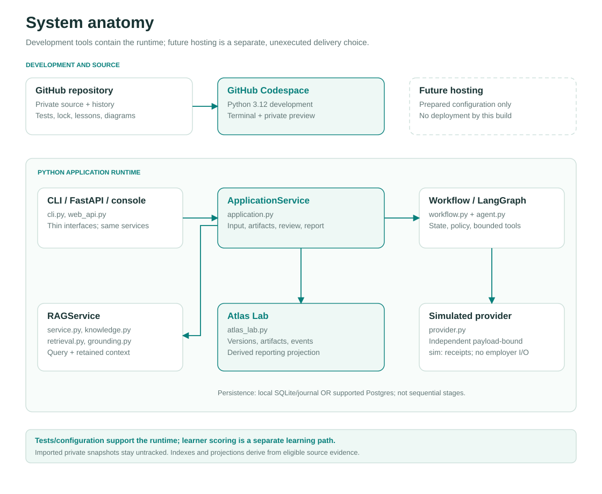

# ANATOMY-01 - Read the working system



## Read boundaries before arrows

GitHub stores source/history; Codespaces provides a development environment. Neither is a node executed for every application request. At runtime, thin CLI/API interfaces call the shared application service. That service coordinates input contracts, Atlas Lab knowledge/artifacts, RAG and the LangGraph workflow. The workflow validates proposals, pauses for exact review and uses a simulated provider with independent receipts. Indexes and reporting views are derived, not new authority.

## Trace one concrete path

Trace an inspect-only goal into retrieval and back to a result. Then compare an application goal: preparation produces content and review state before any simulation effect. Look at both plan completion and full-unit evidence; they are different outputs.

## Read the actual implementation

- [src/l1_lab/application.py](../../src/l1_lab/application.py) :: `ApplicationService.prepare`

- [src/l1_lab/application.py](../../src/l1_lab/application.py) :: `ApplicationService.resume`

- [src/l1_lab/application.py](../../src/l1_lab/application.py) :: `ApplicationService.get`

- [src/l1_lab/service.py](../../src/l1_lab/service.py) :: `RAGService.answer`

- [src/l1_lab/workflow.py](../../src/l1_lab/workflow.py) :: `Workflow`

- [src/l1_lab/cli.py](../../src/l1_lab/cli.py) :: `main`

Open the linked source and tests before explaining behavior; use the current checkout, not remembered line numbers.

## One optional experiment

Trace an inspect-only goal and compare its completion gates with an application goal.

**Safe boundary:** Use the synthetic store and existing interfaces; change no application code.

```bash
uv run pytest tests/test_workflow.py::test_read_only_plan_completion_is_not_full_unit_completion -q
```

Record the actual command/result. A passing targeted test supports that behavior; it does not establish personal mastery or untested paths.

## Boundary and alternative

Local persistence and optional Postgres are alternative deployment contracts, not consecutive processing stages. Future hosting is prepared separately and is not part of a Codespace preview. Learner scoring is outside the application-request path.

## Interview discussion

**L1:** Trace one validated job through the modules and identify the first human-review boundary.

**L2:** Explain why one modular Python application is appropriate here and when a queue or service split would become necessary.

These are original preparation prompts, not known employer questions. Keep fresh mock variants separate.

## Exact public test targets

- `tests/test_service.py::test_integrated_evidence_workflow_pauses`

- `tests/test_workflow.py::test_read_only_plan_completion_is_not_full_unit_completion`
