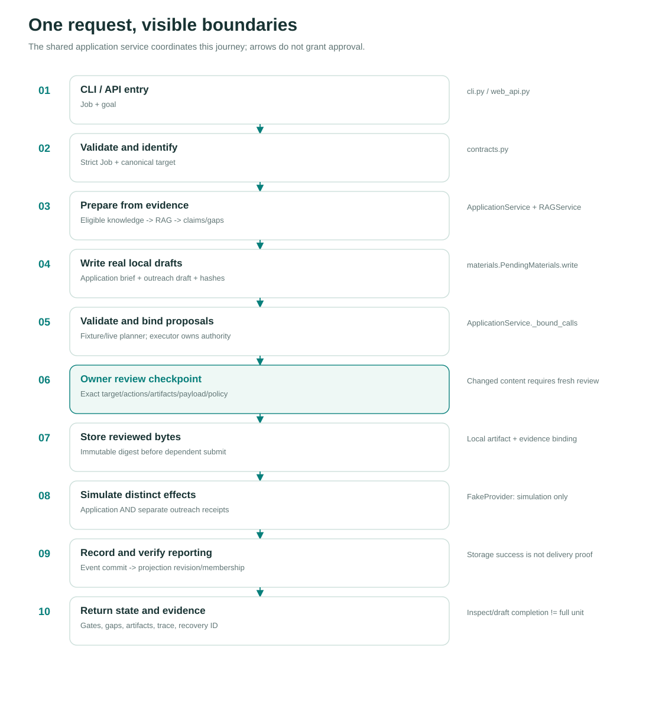

# CONTRACTS-01 - JSON is input, not a contract



## Decoded JSON is not yet a Job

JSON decoding produces dictionaries, lists, strings, numbers and Booleans. Pydantic then validates the strict Job model. parse_job rejects non-object input and non-finite JSON constants; the model enforces required fields, no extras, nonblank strings, skills and bounded integer calls. normalize_identity creates a comparable key without mutating the caller's seen set. These are ordinary Python functions, not model reasoning.

## Trace one concrete path

Use {"title":"AI Engineer","company":"Example Labs","requisition_id":"AI-17","skills":["Python"],"max_calls":8}. Follow decoding, field validation and normalized identity. Replace 8 with true and identify the exact rejection boundary: bool is an int subclass in Python, but not an acceptable budget here.

## Read the actual implementation

- [src/l1_lab/contracts.py](../../src/l1_lab/contracts.py) :: `Job`

- [src/l1_lab/contracts.py](../../src/l1_lab/contracts.py) :: `parse_job`

- [src/l1_lab/contracts.py](../../src/l1_lab/contracts.py) :: `normalize_identity`

Open the linked source and tests before explaining behavior; use the current checkout, not remembered line numbers.

## One optional experiment

In an isolated input fixture, compare max_calls=8 with true, a numeric string, and a blank skill.

**Safe boundary:** Create an ignored .lab/experiments input copy; do not change the working Job contract or committed fixture.

```bash
uv run pytest tests/test_contracts.py -q
```

Record the actual command/result. A passing targeted test supports that behavior; it does not establish personal mastery or untested paths.

## Boundary and alternative

Strict validation avoids guessing caller intent; coercion can be reasonable under a different explicitly versioned contract. Unicode normalization and whitespace/case rules are identity policy. Changing them may change duplicate detection, so test equivalent and genuinely distinct keys.

## Interview discussion

**L1:** Explain the Python objects created by JSON decoding and why Boolean-as-integer needs a strict boundary.

**L2:** Defend strict validation versus coercion and explain how a versioned API schema could evolve safely.

These are original preparation prompts, not known employer questions. Keep fresh mock variants separate.

## Exact public test targets

- `tests/test_contracts.py::test_valid_job`

- `tests/test_contracts.py::test_strict_budget`

- `tests/test_contracts.py::test_duplicate_normalized_identity`
