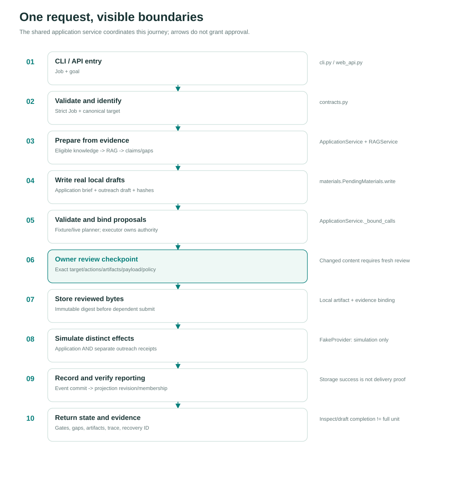

# AGENT-01 - Proposals do not grant permission



## Separate proposals from execution authority

OfflinePlanner proposes deterministic fixture plans. OpenAIPlanner is a separate optional real-model adapter. Both produce data that must pass the same registry, strict argument schema, allowlist and budget checks. validate_tool_call returns detached arguments so later caller mutation cannot change the accepted call. The executor owns authority; neither a model proposal nor retrieved instructions can approve effects.

## Trace one concrete path

Follow a retrieve_evidence proposal through the tool name, allowed set, QueryArgs model and remaining budget. Then read retry_allowed: attempt 1 is the initial execution, while max_retries counts additional executions. Only declared known pre-effect transient failures qualify.

## Read the actual implementation

- [src/l1_lab/agent.py](../../src/l1_lab/agent.py) :: `validate_tool_call`

- [src/l1_lab/agent.py](../../src/l1_lab/agent.py) :: `retry_allowed`

- [src/l1_lab/planner.py](../../src/l1_lab/planner.py) :: `OfflinePlanner.plan`

- [src/l1_lab/openai_adapter.py](../../src/l1_lab/openai_adapter.py) :: `OpenAIPlanner.plan`

Open the linked source and tests before explaining behavior; use the current checkout, not remembered line numbers.

## One optional experiment

Propose an unknown tool and inspect rejection before any provider effect.

**Safe boundary:** Use an injected planner in a standalone experiment/test with a temporary store, never a shell or browser tool.

```bash
uv run pytest tests/test_workflow.py::test_unknown_tool_blocks_before_any_effect -q
```

Record the actual command/result. A passing targeted test supports that behavior; it does not establish personal mastery or untested paths.

## Boundary and alternative

A graph is helpful for explicit state and recovery; a short script may be sufficient for a stateless fixed task. This lab does not implement every agent pattern. Unknown outcomes require reconciliation, not repeated automatic execution.

## Interview discussion

**L1:** Trace a tool proposal through name, permission, schema, budget and execution checks.

**L2:** Compare this plan-and-execute design with routing, ReAct and an ordinary script without claiming all patterns are implemented.

These are original preparation prompts, not known employer questions. Keep fresh mock variants separate.

## Exact public test targets

- `tests/test_agent.py::test_permissions_and_detached_arguments`

- `tests/test_agent.py::test_retry_attempts_vs_additional_retries`

- `tests/test_planner.py::test_different_goals_select_different_fixture_plans`

- `tests/test_openai_adapter.py::test_live_plan_contract_without_network`
