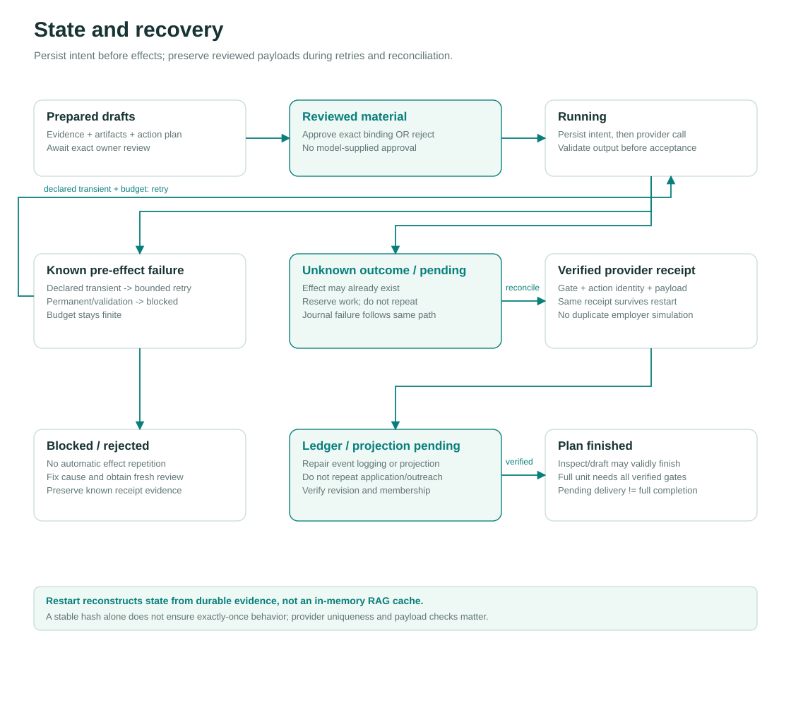

# WORKFLOW-01 - Review, receipts and recovery



## Persist intent, then distinguish outcomes

LangGraph connects ordinary Python functions over explicit run state. A durable intent precedes a consequential simulation action. Review binds the saved target, plan, artifact/payload identity and relevant policy. Provider receipts are stored independently of the journal so a failed response or journal write cannot erase the effect. Stable keys help only because the provider enforces uniqueness and payload binding.

## Trace one concrete path

Read the unknown-outcome test: the provider commits one effect and raises UnknownOutcome. The run stays pending with reserved work. A new engine loads the intent, looks up the same receipt and accepts it after verifying its gate, identity and payload binding. It must not regenerate the reviewed payload.

## Read the actual implementation

- [src/l1_lab/workflow.py](../../src/l1_lab/workflow.py) :: `Workflow.start`

- [src/l1_lab/workflow.py](../../src/l1_lab/workflow.py) :: `Workflow.resume`

- [src/l1_lab/provider.py](../../src/l1_lab/provider.py) :: `FakeProvider.execute`

- [src/l1_lab/provider.py](../../src/l1_lab/provider.py) :: `FakeProvider.reconcile`

- [src/l1_lab/agent.py](../../src/l1_lab/agent.py) :: `completion_gates`

Open the linked source and tests before explaining behavior; use the current checkout, not remembered line numbers.

## One optional experiment

Inject effect-success/response-timeout, restart the engine, and reconcile the same action.

**Safe boundary:** Use FakeProvider and a fresh temporary directory; preserve the first receipt and exact payload.

```bash
uv run pytest tests/test_workflow.py::test_unknown_outcome_reserves_capacity_until_reconciliation -q
```

Record the actual command/result. A passing targeted test supports that behavior; it does not establish personal mastery or untested paths.

## Boundary and alternative

A known pre-effect transient failure may retry within bounds. Invalid output, stale approval and permanent errors block/review. Event/projection repair is downstream bookkeeping, not permission to repeat application/outreach. A completed plan does not itself establish all five unit gates.

## Interview discussion

**L1:** Explain what survives a process failure and why an unknown outcome must be reconciled before retry.

**L2:** Explain the limits of provider idempotency, approval binding and transaction boundaries across independent stores.

These are original preparation prompts, not known employer questions. Keep fresh mock variants separate.

## Exact public test targets

- `tests/test_workflow.py::test_unknown_outcome_reserves_capacity_until_reconciliation`

- `tests/test_workflow.py::test_effect_success_then_journal_failure_recovers_without_duplicate`

- `tests/test_workflow.py::test_changed_payload_cannot_receive_old_receipt_credit_on_resume`

- `tests/test_workflow.py::test_pending_delivery_cannot_complete`
