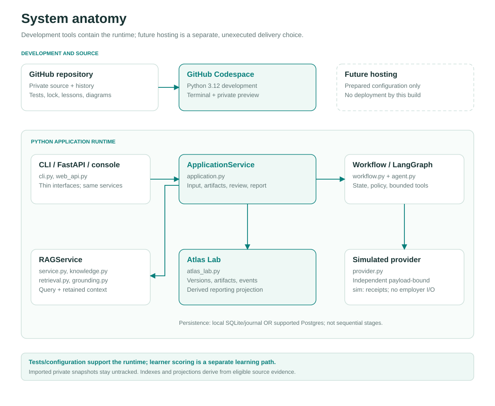

# ATLAS-01 - Knowledge is versioned evidence



## Source trust and action review are different

Atlas Lab is an isolated knowledge/evidence store with immutable versions, approval/provenance, artifacts, simulation events and a derived projection. It is not operational Atlas or a write adapter to Sheets/Drive. Imported real snapshot approval is a recorded source fact; local owner approval concerns a particular proposed action. Neither substitutes for the other.

## Trace one concrete path

Start at AtlasSnapshotSource and select_records. Trace record_id, record_version, source_ref/source_version, native content_hash, approval, snapshot revision and retrieval time. Resolve the latest version before approval filtering so a revoked newer record cannot resurrect an older approved one. Inspect the new Atlas Lab store API alongside these ingestion checks.

## Read the actual implementation

- [src/l1_lab/atlas_lab.py](../../src/l1_lab/atlas_lab.py) :: `AtlasLab.import_snapshot`

- [src/l1_lab/atlas_lab.py](../../src/l1_lab/atlas_lab.py) :: `AtlasLab.review`

- [src/l1_lab/atlas_lab.py](../../src/l1_lab/atlas_lab.py) :: `AtlasLab.store_artifact`

- [src/l1_lab/atlas_lab.py](../../src/l1_lab/atlas_lab.py) :: `AtlasLab.record_event`

- [src/l1_lab/atlas_lab.py](../../src/l1_lab/atlas_lab.py) :: `AtlasLab.project`

- [src/l1_lab/atlas_lab.py](../../src/l1_lab/atlas_lab.py) :: `AtlasLab.projection`

- [src/l1_lab/knowledge.py](../../src/l1_lab/knowledge.py) :: `AtlasSnapshotSource`

- [src/l1_lab/knowledge.py](../../src/l1_lab/knowledge.py) :: `select_records`

Open the linked source and tests before explaining behavior; use the current checkout, not remembered line numbers.

## One optional experiment

In a synthetic record copy, introduce a newer revoked version and inspect the selected corpus.

**Safe boundary:** Only synthetic lab records are editable; imported real snapshots remain read-only and outside Git.

```bash
uv run pytest tests/test_atlas_lab.py::AtlasLabTests::test_synthetic_create_edit_review_and_revoke_are_immutable_versions -q
```

Record the actual command/result. A passing targeted test supports that behavior; it does not establish personal mastery or untested paths.

## Boundary and alternative

Source hash, sanitized export hash, chunk identity and artifact byte digest identify different objects. Imported real records remain read-only; experiments fork synthetic versions. Index refresh and projection membership must be checked separately from a successful database write.

## Interview discussion

**L1:** Distinguish a source record version, snapshot revision, source hash, export hash and action approval.

**L2:** Explain optimistic concurrency and why a reporting projection must be verified separately from event storage.

These are original preparation prompts, not known employer questions. Keep fresh mock variants separate.

## Exact public test targets

- `tests/test_atlas_lab.py::AtlasLabTests::test_synthetic_create_edit_review_and_revoke_are_immutable_versions`

- `tests/test_atlas_lab.py::AtlasLabTests::test_imported_source_is_read_only_and_native_hash_stays_distinct`

- `tests/test_atlas_lab.py::AtlasLabTests::test_five_distinct_events_need_separate_projection_membership_readback`

- `tests/test_atlas_lab.py::AtlasLabTests::test_projection_failure_or_same_revision_membership_corruption_repairs_without_effect_repeat`

- `tests/test_knowledge.py::test_latest_revocation_does_not_resurrect_old_approval`

- `tests/test_knowledge.py::test_selection_preserves_native_hash_and_keeps_text_hash_separate`

- `tests/test_knowledge.py::test_mixed_revisions_fail_and_sensitive_metadata_is_rejected`
