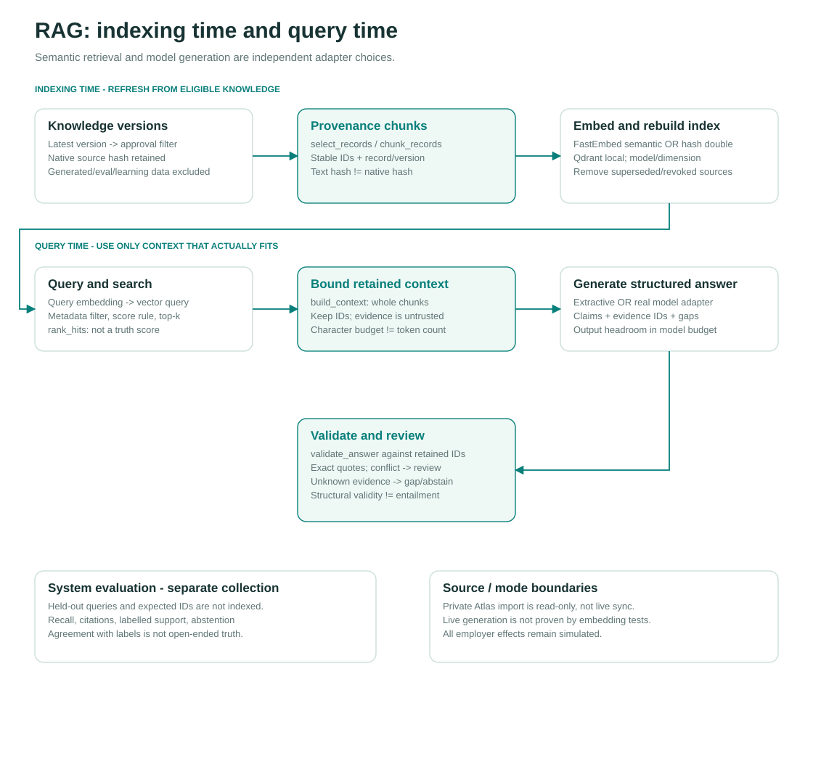

# RAG-01 - Ingest and chunk without losing provenance



## Chunks keep their source identity

The ingestion path accepts a bounded snapshot envelope, validates record provenance, resolves eligible versions and creates meaningful chunks. Each chunk carries its parent identity/version and source metadata. Deterministic chunk identity changes when the source version or text changes. Duplicate same-version content can collapse; contradictory same-version payloads must not be silently selected.

## Trace one concrete path

Follow one synthetic record through load_snapshot, select_records and chunk_records. Inspect the resulting text, chunk ID, native source hash and computed text hash. Change a copied version/text and compare identities. The chunk is a retrieval unit, not a replacement for the source record.

## Read the actual implementation

- [src/l1_lab/knowledge.py](../../src/l1_lab/knowledge.py) :: `load_snapshot`

- [src/l1_lab/knowledge.py](../../src/l1_lab/knowledge.py) :: `select_records`

- [src/l1_lab/knowledge.py](../../src/l1_lab/knowledge.py) :: `chunk_records`

Open the linked source and tests before explaining behavior; use the current checkout, not remembered line numbers.

## One optional experiment

Change a synthetic record version/text and compare its chunk IDs and source metadata.

**Safe boundary:** Use a copied synthetic fixture or an in-memory dictionary; do not index generated drafts, practice answers or evaluation labels.

```bash
uv run pytest tests/test_knowledge.py::test_chunks_retain_provenance_and_change_identity_with_version -q
```

Record the actual command/result. A passing targeted test supports that behavior; it does not establish personal mastery or untested paths.

## Boundary and alternative

Only eligible candidate/project knowledge enters this index. Generated drafts, receipts, learning answers, evaluation labels and starred development references are different collections. A file snapshot is not continuous synchronization; removed/revoked/superseded records need atomic corpus/index refresh.

## Interview discussion

**L1:** Trace a native record through selection and chunking while naming each preserved field.

**L2:** Compare chunk size, update semantics and provenance granularity for a small evidence store versus a large corpus.

These are original preparation prompts, not known employer questions. Keep fresh mock variants separate.

## Exact public test targets

- `tests/test_knowledge.py::test_equal_duplicate_collapses_but_conflicting_same_version_fails`

- `tests/test_knowledge.py::test_chunks_retain_provenance_and_change_identity_with_version`

- `tests/test_knowledge.py::test_nonapproved_chunk_input_fails`
