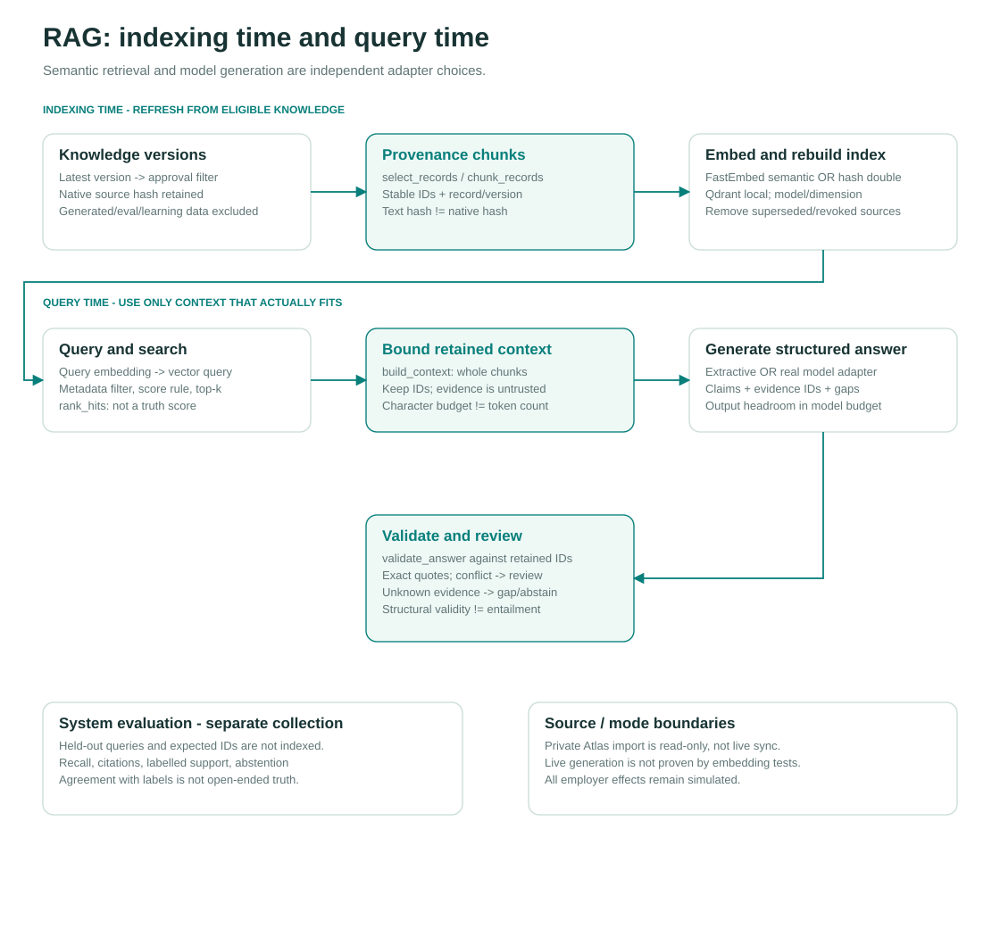

# RETRIEVAL-01 - Similarity is a candidate signal



## Similarity proposes evidence candidates

FastEmbedEmbedding uses an actual local model; HashEmbedding is an explicitly nonsemantic deterministic test double. VectorIndex inserts chunks into Qdrant local and records model, dimension and normalization. rank_hits validates scores/settings, filters metadata and threshold, then uses a deterministic ordering before top-k. A nearest point can still be irrelevant.

## Trace one concrete path

For a tiny exact example, query [1,0] and candidate [1,0] have cosine 1, while [0,1] has cosine 0. This explains the operation, not real text embeddings. Inspect a real returned chunk and metadata, then compare score filtering and top-k. Read the semantic test separately from fake-vector tests.

## Read the actual implementation

- [src/l1_lab/retrieval.py](../../src/l1_lab/retrieval.py) :: `FastEmbedEmbedding`

- [src/l1_lab/retrieval.py](../../src/l1_lab/retrieval.py) :: `VectorIndex.search`

- [src/l1_lab/retrieval.py](../../src/l1_lab/retrieval.py) :: `rank_hits`

Open the linked source and tests before explaining behavior; use the current checkout, not remembered line numbers.

## One optional experiment

Compare top-k, a metadata filter and a stricter relevance threshold on a development query.

**Safe boundary:** Keep held-out labels unchanged and outside the index; never relabel hash vectors as semantic embeddings.

```bash
uv run pytest tests/test_retrieval.py::test_rank_filters_before_top_k_and_ties_are_stable -q
```

Record the actual command/result. A passing targeted test supports that behavior; it does not establish personal mastery or untested paths.

## Boundary and alternative

A relevance threshold is calibrated on development examples, not tuned secretly against held-out answers. Semantic model downloads, memory, cache lifecycle and index rebuild have costs. A hosted hash cache must never be advertised as semantic retrieval. Report actual semantic execution separately.

## Interview discussion

**L1:** Explain filtering versus ranking and why a nearest result can still be irrelevant.

**L2:** Defend model, threshold, refresh and hosting choices using calibration evidence, memory and cold-start constraints.

These are original preparation prompts, not known employer questions. Keep fresh mock variants separate.

## Exact public test targets

- `tests/test_retrieval.py::test_rank_filters_before_top_k_and_ties_are_stable`

- `tests/test_retrieval.py::test_rebuild_removes_old_evidence_and_disk_local_reopens`

- `tests/test_semantic.py::test_actual_fastembed_and_qdrant_semantic_path`
