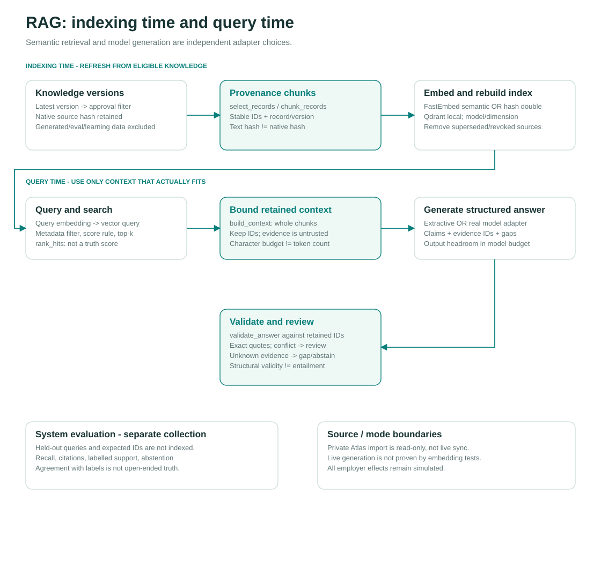

# GROUNDING-01 - Bound context, then validate the answer



## Validate against retained context

RAGService coordinates search, context selection, generation and output validation; it is not merely a final step after RAG. build_context includes whole chunks in a bounded untrusted-evidence envelope. Only retained chunk IDs are passed to the generator and citation validator. validate_answer checks shape, ID membership, exact quotes and conservative conflict/review rules.

## Trace one concrete path

Reduce max_chars and inspect context_chunk_ids versus retrieved_chunks. A chunk that was retrieved but did not fit cannot be cited by the answer. An absent relevant source should become a gap/abstention. Conflicting maturity/contribution evidence must remain visible rather than becoming a stronger career claim.

## Read the actual implementation

- [src/l1_lab/grounding.py](../../src/l1_lab/grounding.py) :: `build_context`

- [src/l1_lab/grounding.py](../../src/l1_lab/grounding.py) :: `validate_answer`

- [src/l1_lab/service.py](../../src/l1_lab/service.py) :: `RAGService.answer`

- [src/l1_lab/openai_adapter.py](../../src/l1_lab/openai_adapter.py) :: `OpenAIAnswerGenerator.generate`

Open the linked source and tests before explaining behavior; use the current checkout, not remembered line numbers.

## One optional experiment

Shrink the context budget until one whole source no longer fits and test that it cannot be cited.

**Safe boundary:** Change only an experiment parameter; use retained context IDs, never all retrieved IDs, for generation and validation.

```bash
uv run pytest tests/test_service.py::test_context_budget_only_retained_citations -q
```

Record the actual command/result. A passing targeted test supports that behavior; it does not establish personal mastery or untested paths.

## Boundary and alternative

A character budget is not exact token accounting; the real-model path needs a declared token limit/estimate plus output headroom. Valid JSON, citation membership and exact quotations do not prove semantic entailment. Document/job instructions remain data and cannot grant tool permissions.

## Interview discussion

**L1:** Distinguish retrieved chunks, retained context, citation membership, accurate quotation and semantic support.

**L2:** Design a conservative token budget and claim-support evaluation without treating temperature zero or valid JSON as truth.

These are original preparation prompts, not known employer questions. Keep fresh mock variants separate.

## Exact public test targets

- `tests/test_grounding.py::test_context_budget_counts_envelope_and_escapes_keeps_whole_chunks`

- `tests/test_grounding.py::test_quote_must_be_exact_and_from_a_cited_hit`

- `tests/test_grounding.py::test_structural_checks_are_not_semantic_truth_checks`

- `tests/test_service.py::test_context_budget_only_retained_citations`
