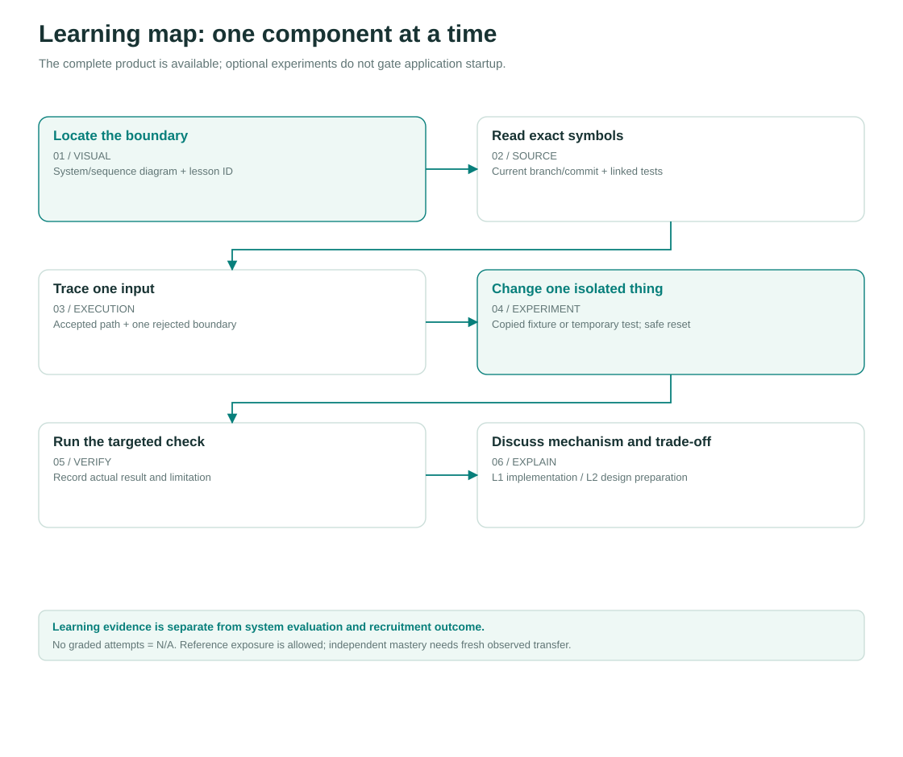

# EVALUATION-01 - Measure the system and the learner separately



## Separate system quality from learning evidence

evaluate measures retrieval recall, citation validity, labelled support, abstention and task outcomes separately. compare_runs aligns stable case IDs, reports missing/new cases and handles numeric boundaries. compute_metrics is a different path: it uses observed graded learner attempts, explicit assistance and a declared rubric. Passing system tests cannot create explanation or independence points.

## Trace one concrete path

Shuffle score rows and remove one case. Follow ID alignment and denominators instead of positional zip. Then inspect an empty learner checkpoint: knowledge accuracy has no denominator and remains N/A. Assisted work can inform learning while being excluded from independent mastery evidence.

## Read the actual implementation

- [src/l1_lab/evaluation.py](../../src/l1_lab/evaluation.py) :: `evaluate`

- [src/l1_lab/evaluation.py](../../src/l1_lab/evaluation.py) :: `compare_runs`

- [src/l1_lab/progress.py](../../src/l1_lab/progress.py) :: `compute_metrics`

- [src/l1_lab/observability.py](../../src/l1_lab/observability.py) :: `LocalTelemetry.span`

- [src/l1_lab/observability.py](../../src/l1_lab/observability.py) :: `JSONLSpanExporter.export`

- [src/l1_lab/observability.py](../../src/l1_lab/observability.py) :: `safe_attributes`

Open the linked source and tests before explaining behavior; use the current checkout, not remembered line numbers.

## One optional experiment

Shuffle evaluation rows and remove one case; compare by stable case ID and inspect missing-case reporting.

**Safe boundary:** Use a copied score list. Do not change held-out labels, create personal scores from test passes, or invent timings.

```bash
uv run pytest tests/test_evaluation.py::test_regression_aligns_ids_and_reports_missing_new -q
```

Record the actual command/result. A passing targeted test supports that behavior; it does not establish personal mastery or untested paths.

## Boundary and alternative

Small labelled fixtures are not an expert truth oracle. Structural citation checks can pass a fabricated claim, so support evaluation needs additional labels/review. OpenTelemetry spans/exports record observable events, not hidden reasoning. Do not invent token usage, measured latency, cost, production adoption or hiring probability.

## Interview discussion

**L1:** State the numerator and denominator for retrieval recall, citation validity, support and abstention.

**L2:** Propose a release gate that accounts for sample coverage, semantic limitations, missing cases and rollback.

These are original preparation prompts, not known employer questions. Keep fresh mock variants separate.

## Exact public test targets

- `tests/test_evaluation.py::test_regression_aligns_ids_and_reports_missing_new`

- `tests/test_evaluation.py::test_valid_citation_with_fabricated_claim_fails_extractive_support_proxy`

- `tests/test_progress.py::test_no_attempts_have_no_accuracy_or_mastery_evidence`

- `tests/test_progress.py::test_missing_assistance_declaration_cannot_establish_independent_mastery`

- `tests/test_observability.py::test_real_sdk_spans_have_parent_identity_and_measured_duration`

- `tests/test_observability.py::test_exception_message_stack_and_request_content_are_not_recorded`
