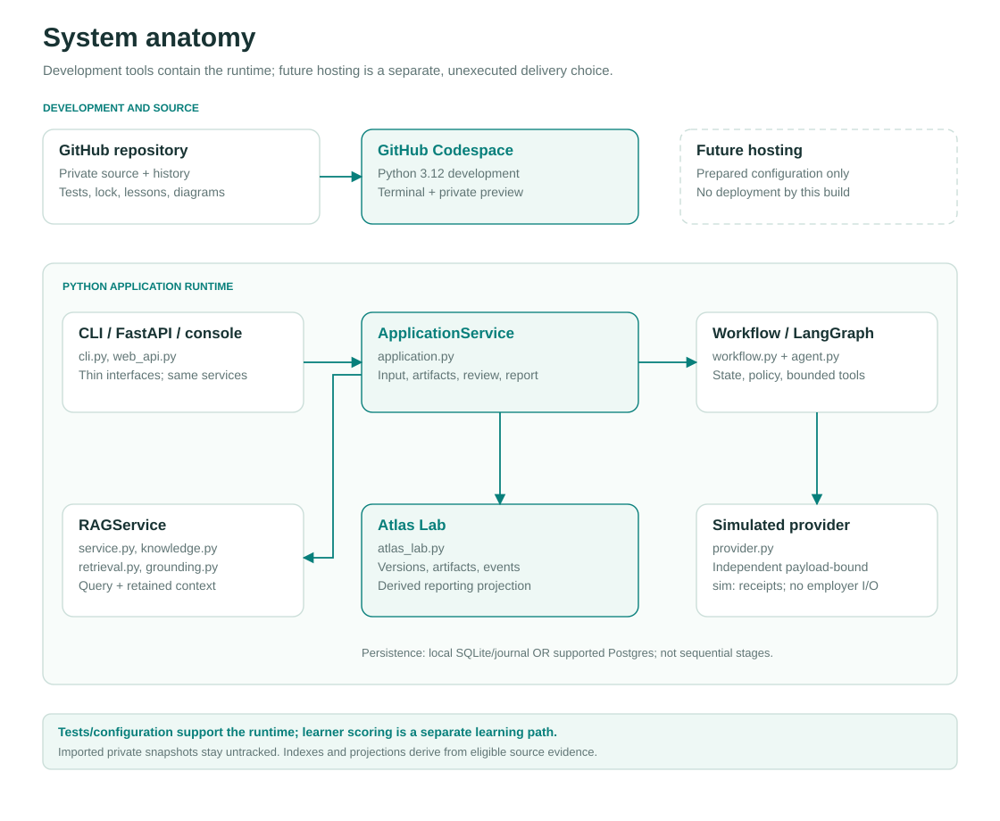

# DELIVERY-01 - Interfaces, packaging and future hosting



## Thin interfaces, explicit persistence

The CLI and browser/API reuse application services rather than duplicating business rules in route handlers. Authentication, request-size limits and schema validation precede mutation. Packaging resources must work in an editable checkout and an installed wheel. The local journal/SQLite path and optional Postgres path are alternative persistence contracts with distinct operational requirements.

## Trace one concrete path

Read an authenticated API route and the test proving rejection before storage work. Follow one route to the shared application service, then inspect its actual JSON error/status. Compare the private forwarded Codespace console with the prepared future-host configuration: the latter is not an executed deployment.

## Read the actual implementation

- [src/l1_lab/api.py](../../src/l1_lab/api.py) :: `fit`

- [src/l1_lab/web_api.py](../../src/l1_lab/web_api.py) :: `create_run`

- [src/l1_lab/web_api.py](../../src/l1_lab/web_api.py) :: `ConsoleBoundary`

- [src/l1_lab/cli.py](../../src/l1_lab/cli.py) :: `main`

Open the linked source and tests before explaining behavior; use the current checkout, not remembered line numbers.

## One optional experiment

Send a rejected request to an isolated API client and prove that storage/provider work did not occur.

**Safe boundary:** Use the test app and temporary store. Do not deploy, expose a public port or provision a service.

```bash
uv run pytest tests/test_web_api.py::test_authentication_happens_before_storage_or_work -q
```

Record the actual command/result. A passing targeted test supports that behavior; it does not establish personal mastery or untested paths.

## Boundary and alternative

MCP is a protocol boundary with discovery, argument schema and invocation, not just a Python function registry. Read docs/MCP.md and its genuine protocol tests when exercising that extension. Future hosting needs durable reviewed state, explicit retrieval mode, migrations, secrets separation and rollback planning; no deployment is authorized by this build.

## Interview discussion

**L1:** Trace validation and authentication before mutation and explain how resources load from an installed wheel.

**L2:** Compare a private Codespace preview with a durable hosted service and explain MCP discovery versus a Python function registry.

These are original preparation prompts, not known employer questions. Keep fresh mock variants separate.

## Exact public test targets

- `tests/test_web_api.py::test_authentication_happens_before_storage_or_work`

- `tests/test_web_api.py::test_body_limit_counts_actual_bytes_before_json_or_work`

- `tests/test_web_api.py::test_asset_allowlist_and_console_redirect`
